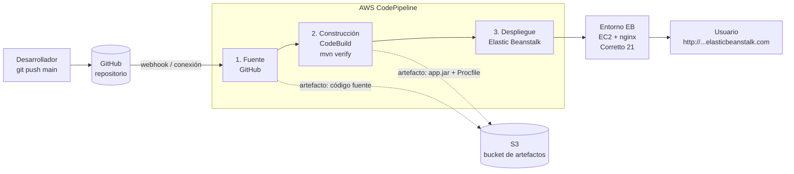

# students-pipeline-api

API REST de gestión de estudiantes (Java 21 + Spring Boot) desplegada automáticamente con
**AWS CodePipeline → AWS CodeBuild → AWS Elastic Beanstalk**.

Taller — Actividad 5, Unidad 3 (Integración y entrega continua), Herramientas de Software II, Universidad de La Salle.

## Arquitectura del pipeline



| Etapa | Servicio | Qué hace | Entrada → Salida |
|---|---|---|---|
| Fuente | GitHub (conexión de CodePipeline) | Detecta el push a `main` y descarga el código | repo → `SourceArtifact` (zip en S3) |
| Construcción | CodeBuild | Compila, corre 5 tests JUnit y empaqueta | `SourceArtifact` → `BuildArtifact` (`app.jar` + `Procfile`) |
| Despliegue | Elastic Beanstalk | Reemplaza la versión en la instancia EC2 | `BuildArtifact` → nueva versión en línea |

Si un test falla, CodeBuild termina en `FAILED` y el pipeline se detiene: **no se despliega código roto**.

## Endpoints

| Método | Ruta | Descripción |
|---|---|---|
| GET | `/` y `/health` | Estado + `version` (lo que se cambia en la demo) |
| GET | `/api/students` | Lista estudiantes |
| GET | `/api/students/{id}` | Obtiene uno (404 si no existe) |
| POST | `/api/students` | Crea (valida nombre, email y programa) |
| PUT | `/api/students/{id}` | Actualiza |
| DELETE | `/api/students/{id}` | Elimina |

Datos en memoria: se reinician en cada despliegue (suficiente para demostrar el pipeline).

## Archivos clave para el pipeline

- `buildspec.yml` — instrucciones de CodeBuild (Corretto 21, `mvn verify`, reportes JUnit, artefacto).
- `Procfile` — le dice a Beanstalk cómo arrancar: `java -jar app.jar`.
- `application.properties` — `server.port=${PORT:5000}` (nginx de Beanstalk reenvía al 5000) y `app.version`.
- `pom.xml` — `<finalName>app</finalName>` para que el jar siempre se llame `app.jar`.

---

# Guía paso a paso (cuenta personal de AWS)

> **Región:** `us-east-1` (N. Virginia) en todos los servicios.
> **Por qué cuenta personal y no AWS Academy Learner Lab:** el Learner Lab bloquea
> `codeconnections:*` (AccessDeniedException), así que CodePipeline no puede conectarse a GitHub.
> En una cuenta personal cada asistente puede crear sus propios roles de servicio.
>
> **Costos:** CodePipeline, CodeBuild y una instancia `t3.micro` entran en la capa gratuita o cuestan centavos.
> Antes de empezar, crea un presupuesto en **Billing → Budgets → Zero spend budget** para recibir
> un correo si algo empieza a cobrar. Al terminar, haz la limpieza del Paso 7.
>
> 📸 = captura para el informe / video.

## Paso 0 — Probar en local (5 min)

```bash
mvn verify                  # debe terminar con: Tests run: 5, Failures: 0 ... BUILD SUCCESS
java -jar target/app.jar    # abrir http://localhost:5000/health
```
**Por qué:** si falla aquí, también fallará en CodeBuild; es más rápido corregirlo en tu máquina.

## Paso 1 — Subir el repo a GitHub

```bash
git init && git add . && git commit -m "feat: API de estudiantes + buildspec para CodePipeline"
git branch -M main
git remote add origin https://github.com/<tu-usuario>/students-pipeline-api.git
git push -u origin main
```
📸 Repo en GitHub mostrando `buildspec.yml` y `Procfile` en la raíz.

## Paso 2 — Verificar la conexión con GitHub (ANTES de lo demás)

Consola → **CodePipeline** → menú izquierdo **Settings → Connections** → **Create connection** →
proveedor **GitHub** → nombre `github-unisalle` → **Connect to GitHub** → **Install a new app**
(autoriza el repo) → **Connect**. Debe quedar en estado **Available**.

**Por qué primero:** el pipeline necesita esta conexión ya autorizada para leer el repo.
En *Repository access* da acceso solo a `students-pipeline-api` (mínimo privilegio).

📸 Conexión en estado *Available*.

## Paso 3 — Crear la aplicación y el entorno de Elastic Beanstalk

**3.0 Rol para las instancias EC2 (solo la primera vez).** Beanstalk necesita un *instance profile*
que el asistente no siempre crea solo:
IAM → **Roles** → **Create role** → Trusted entity *AWS service* → Use case **EC2** → políticas
`AWSElasticBeanstalkWebTier`, `AWSElasticBeanstalkWorkerTier` y `AWSElasticBeanstalkMulticontainerDocker`
→ nombre **`aws-elasticbeanstalk-ec2-role`** → Create.

Consola → **Elastic Beanstalk** → **Create application**:

1. **Environment tier:** Web server environment.
2. **Application name:** `students-pipeline-api`. Environment name: `students-pipeline-api-env`.
3. **Platform:** Java → branch **Corretto 21 running on 64bit Amazon Linux 2023** → versión recomendada.
4. **Application code:** *Sample application* (el pipeline subirá la nuestra después).
5. **Presets:** *Single instance (free tier eligible)* — sin balanceador, más barato y rápido.
6. **Service access:**
   - Service role: **Create and use new service role** (`aws-elasticbeanstalk-service-role`)
   - EC2 key pair: ninguno (no hace falta SSH)
   - EC2 instance profile: **`aws-elasticbeanstalk-ec2-role`** (el del paso 3.0)
7. Lo demás por defecto; en *Instance types* deja solo **`t3.micro`** → **Create**.

Espera 5–8 min hasta **Health: Ok** y abre la URL del entorno (verás la página de ejemplo de AWS).

**Por qué:** la etapa de despliegue de CodePipeline necesita un entorno de Beanstalk existente al cual apuntar.

📸 Entorno en verde con su URL.

## Paso 4 — Crear el pipeline (incluye el proyecto de CodeBuild)

Consola → **CodePipeline** → **Create pipeline** → **Build custom pipeline**:

**4.1 Configuración**
- Name: `students-pipeline`
- Execution mode: *Superseded* · Pipeline type: V2
- Service role: **New service role** (el asistente lo crea con los permisos necesarios)
- Advanced settings: Artifact store por defecto (crea el bucket S3 de artefactos).

**4.2 Etapa de Fuente**
- Provider: **GitHub (via GitHub App)** → conexión `github-unisalle`
- Repository: `<tu-usuario>/students-pipeline-api` · Branch: `main`
- Output artifact format: *CodePipeline default*
- Trigger: *Push* en `main` (normalmente ya viene así)

**4.3 Etapa de Construcción** → Provider **AWS CodeBuild** → **Create project** (abre otra ventana):
- Project name: `students-pipeline-build`
- Environment: Managed image · **EC2** · OS **Amazon Linux** · Runtime **Standard** ·
  Image **`aws/codebuild/amazonlinux-x86_64-standard:5.0`**
- Service role: **New service role** (lo crea el asistente)
- Buildspec: **Use a buildspec file** (toma el `buildspec.yml` del repo)
- Logs: CloudWatch activado → **Continue to CodePipeline**
- De vuelta: Build type *Single build* → Next.

**4.4 Etapa de Despliegue**
- Provider: **AWS Elastic Beanstalk**
- Application: `students-pipeline-api` · Environment: `students-pipeline-api-env`
- Input artifact: `BuildArtifact` (el de CodeBuild, **no** el de la fuente)

**4.5** Revisar → **Create pipeline**. Arranca solo la primera ejecución.

**Por qué el input del deploy debe ser `BuildArtifact`:** el código fuente no trae `app.jar`;
solo la salida de CodeBuild contiene el jar compilado y el `Procfile`.

📸 Cada pantalla del asistente (fuente, build, deploy) y el resumen final.

## Paso 5 — Ver la primera ejecución

Las tres etapas deben quedar en verde (~5–8 min en total).
- En **CodeBuild → Build history → (build) → Reports** se ven los 5 tests pasando.
- En la URL de Beanstalk, `/health` debe responder `"version":"1.0.0"`.

📸 Pipeline en verde · logs de CodeBuild · pestaña Reports · respuesta de `/health` y `/api/students`.

## Paso 6 — Probar el despliegue automático (el corazón del video)

1. En `src/main/resources/application.properties` cambia `app.version=1.0.0` → `app.version=1.1.0`.
2. `git commit -am "chore: version 1.1.0" && git push`
3. En CodePipeline verás una **nueva ejecución iniciada sola** con el mensaje del commit.
4. Al terminar, recarga `/health` → `"version":"1.1.0"`.

📸 Antes/después de `/health` · historial de ejecuciones con los dos commits.

**Demo extra (recomendada para el video):** rompe un test a propósito, por ejemplo cambiando
`.value("UP")` por `.value("DOWN")`, y haz push. El pipeline **se detiene en Construcción** y la app sigue
en 1.1.0. Esto demuestra la integración continua: el código roto no llega a producción. Luego revierte el cambio.

## Paso 7 — Limpieza (evitar cobros)

Al terminar de grabar y entregar:
1. **Elastic Beanstalk → Actions → Terminate environment** (y luego *Delete application*).
2. **CodePipeline** → eliminar `students-pipeline`. **CodeBuild** → eliminar `students-pipeline-build`.
3. **S3** → vaciar y eliminar el bucket `codepipeline-us-east-1-...`.

**Por qué:** la instancia EC2 y su IP pública cobran por hora mientras el entorno exista.

## Problemas comunes

| Síntoma | Causa probable | Solución |
|---|---|---|
| Beanstalk no deja crear el entorno: falta instance profile | No existe el rol de EC2 | Hacer el paso 3.0 |
| CodeBuild: `Unknown runtime version` | Imagen equivocada | Usar `amazonlinux-x86_64-standard:5.0` |
| Beanstalk *Degraded* / 502 Bad Gateway | La app no escucha en el 5000 o no arrancó | Revisar `server.port` y los logs: Beanstalk → Logs → *Request last 100 lines* |
| Deploy falla: no encuentra el jar | Input del deploy = `SourceArtifact` | Cambiarlo a `BuildArtifact` |
